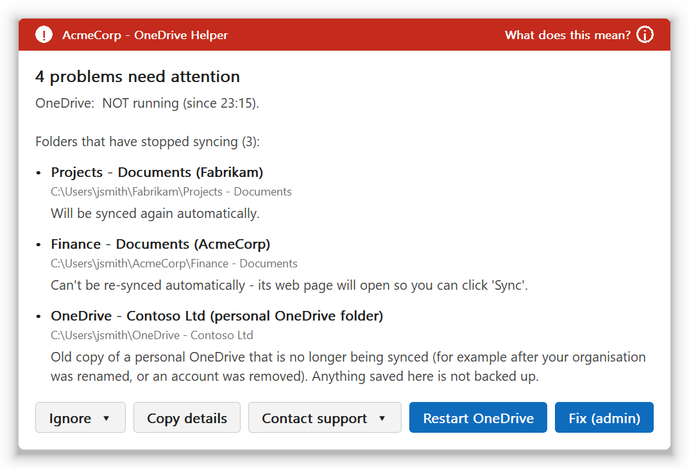
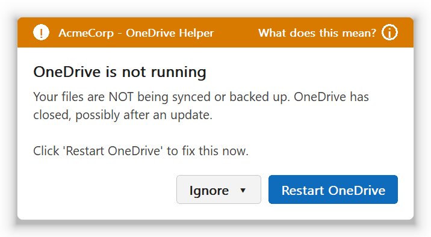
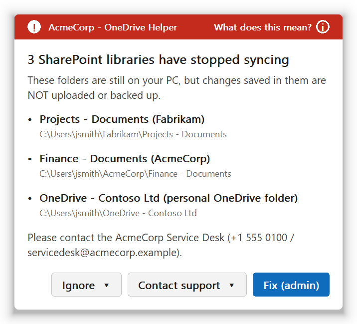
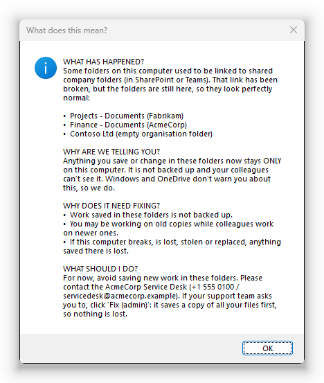
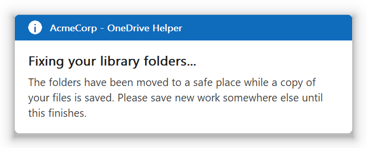
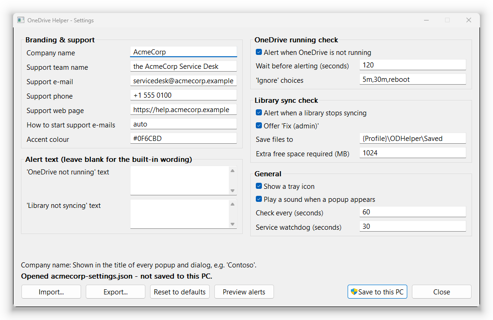

# OneDrive Helper

A small Windows tool that keeps an eye on OneDrive for your users, and tells them (and you) when something has quietly gone wrong.

**Current version: 0.8.0** ([release notes and downloads](https://github.com/denismcapple/OneDriveHelper/releases/latest)). To see which version a PC is running, hover over the OneDrive Helper icon next to the clock, or run `"C:\Program Files\OneDriveHelper\OneDriveHelper.exe" version`.

> **New in 0.8.0: a much safer fix.** The folder fix is the only part of the tool that deletes anything, so it now moves each folder out of the way before saving it, deletes only files it has proven it saved, puts everything back if anything is in doubt, and recovers by itself if it's interrupted. Upgrades wait for a fix in progress, and roll back if they fail. The details are in [How the fix works](#how-the-fix-works).

<p align="center">
  
</p>

## Why we built this

We look after a lot of Microsoft 365 users, and the same two OneDrive problems kept landing on our desk. Both are silent. Nothing on screen tells the user, so we usually only found out when someone went looking for a file that had never made it to the cloud.

**1. OneDrive just stops.** OneDrive updates itself, closes, and sometimes simply doesn't come back. The cloud icon disappears from the taskbar and nobody notices. Until the user reboots or starts OneDrive by hand, nothing they save is backed up and their colleagues don't see their changes. Now it just gets started again.

**2. Folders that look synced but aren't.** A SharePoint or Teams library (for example `C:\Users\jsmith\Fabrikam\Projects - Documents`) is still sitting on the disk, but OneDrive has stopped syncing it. This happens when someone adds a shortcut to the same library, when an organisation is renamed, when an account is removed, or for reasons nobody can explain. The folder looks exactly like it always did. People keep saving work into it for weeks, and none of it goes anywhere.

We got tired of finding out about these the hard way, so we wrote something that checks for both all day long, tells the user in plain English, and gives them (or us) a safe way to fix it.

## What it does

* **Watches OneDrive for every signed-in user, and restarts it when it stops.** If OneDrive isn't running for a couple of minutes (and isn't in the middle of an update), it's quietly restarted, with up to 3 tries about 30 seconds apart. Most of the time the user never knows anything happened. Only if that doesn't work do they get an alert with a **Restart OneDrive** button.
* **Finds folders that have stopped syncing.** It compares what's on disk with what OneDrive is actually syncing. It catches:
  * library folders OneDrive has dropped
  * leftover organisation folders
  * old personal `OneDrive - Something` folders that no account uses any more
* **Explains it in plain English.** Every alert has a **What does this mean?** link written for people who don't know or care how OneDrive works.
* **Makes it easy to get help.** **Contact support** offers to e-mail your service desk with a full diagnostic report already in the message, or to open your support website.
* **Fixes broken folders safely**, after an administrator approves. It moves the folder aside, saves a copy of every file stored on the PC, deletes only the files it has proven it saved, then asks OneDrive to sync the library again. If anything is in doubt, nothing is deleted and the folder goes back where it was.
* **Puts a status icon in the system tray**, so when a user rings you, you can see straight away what's wrong, even if they closed the alert.
* **Writes everything to the Windows event log**, so your RMM can raise a ticket or alert you.
* **Can be branded per customer**: company name, support contact, colours and wording, all set from a settings file you push out with your RMM.

It's written in Go, runs as a normal Windows service, and has no dependencies to install. There's no PowerShell at runtime, no .NET, and no cloud service.

## What users see

**When OneDrive has stopped and couldn't be restarted automatically**

If OneDrive closes, the tool first restarts it by itself, up to 3 attempts, and logs event 3005 when that works. Users only see this alert if every attempt failed.

A few rules keep this sensible:

* If OneDrive keeps crashing straight after starting, the automatic restarts stop after 3 in any 30 minutes, and the user is warned instead of the tool fighting it forever.
* If the user has chosen **Ignore** on this alert (maybe they closed OneDrive on purpose), it isn't restarted behind their back until the ignore period ends.
* Both the automatic restart and the number of attempts can be changed in the settings.



**When folders have stopped syncing**



The alerts appear in the bottom right corner of the screen. They're deliberately not Windows notifications, so they don't get lost among everything else:

* they stay on top
* they don't steal the keyboard while someone is typing
* they stay until the user picks an option

Each alert can be ignored for a while (5 minutes, 30 minutes, until the next restart, or whatever choices you configure). Ignoring one alert doesn't hide the other. If a *new* folder breaks, its alert comes straight back.

**What does this mean?**



**The tray icon** goes green, amber or red:


Hover over it to see the version and a one-line summary, for example "AcmeCorp - OneDrive Helper v0.8.0 / Everything looks good". Click it to see the status window (the screenshot at the top of this page), which also lists any fix that didn't finish. Right-click for:

* show status
* show alerts again
* restart OneDrive
* fix folders
* e-mail support or visit the support website
* copy details for support
* open saved files
* the version number

## How the fix works

Fixing a broken folder means deleting it from the PC, so we were careful:

1. **The user confirms.** They're told which folders will be fixed and whether each one can be reconnected automatically.
2. **An administrator approves through UAC.** Your technician can type their admin credentials on a standard user's PC. The approval step looks at the problem again on its own, shows exactly what will happen (folders, file counts, sizes, free disk space), and logs who approved it. If nobody answers within 15 minutes, the user is told nothing changed (event 5010); the approval window closes itself after 10 minutes, and a late approval does nothing.
3. **The folder is moved out of the way first.** It goes to `C:\Users\<user>\ODHelper\Fixing\<date and time>\`, so nothing (an app, or OneDrive itself) can save into its old location while the fix runs. If something has a file in it open, the folder is skipped and the user is told which program to close (for example "Microsoft Excel has a file in it open") and to try again; other folders carry on. If every folder was skipped, the user is told plainly that nothing was changed.
4. **Files are saved.** Every file actually stored on the PC is copied to `C:\Users\<user>\ODHelper\Saved\<date and time>\<folder>`. Online-only placeholders are skipped because they're already in the cloud. The tool checks there's enough free disk space before it starts. Each copy is written to disk, its size checked, and the original is confirmed unchanged while it was being read.
5. **Only proven copies are deleted.** Before deleting anything, every file is checked again: it must have been copied in this run and be unchanged since, and nothing may have it open for writing. If even one file doesn't pass (or anything new appeared), nothing is deleted and the folder is put back where it was. If OneDrive has started syncing the old location again in the meantime, both copies are kept. A `manifest.json` records every step, before it happens.
6. **OneDrive is asked to sync the library again**, for folders that were fully fixed. Where the library details are known, that's automatic. Otherwise the library's web page opens so the user can click Sync. The leftover shortcuts in Explorer's side panel are cleaned up too.

If the fix is interrupted (a crash, a power cut, the user signing out), the record on disk points at the user's files. The next time the user part starts it either puts the folder back, or reports it once in the status window and in the event log (5007) so you can sort it out. Recovery only ever runs as the user, never with admin rights.

Some safety rules that are always applied:

* It never touches a folder OneDrive is actually syncing; this is checked before the folder is moved and again right before anything is deleted. If OneDrive's settings can't be read, every folder counts as "syncing".
* It only touches folders inside the user's own profile.
* It never touches a folder that contains the user's redirected Desktop or Documents.
* It never follows junctions or symbolic links, and never puts a folder back through one. A folder with a junction or link anywhere in its path below the user's profile is refused (event 5009, naming the link).
* It won't plan a fix while OneDrive's settings can't be read, while OneDrive is running for the user but shows no account yet (starting up or signing in), or while it can't tell whether OneDrive is running (event 5013). The user is asked to sign in to OneDrive first, or to contact support. A user who simply has no OneDrive account, or has signed out of all of them, can still be fixed.
* A folder that couldn't be fully read when the fix was planned is never removed, as the confirmation says.
* A delete that fails part-way (antivirus or a preview holding a file) stops at once. What wasn't deleted stays in the `Fixing` folder and is never moved back half-empty.

**Clearing an unfinished fix.** If the status window or event 5007 reports an unfinished fix, the folder is in `C:\Users\<user>\ODHelper\Fixing\<date and time>\` and its backup in `ODHelper\Saved\<date and time>\`. Check the backup, copy back anything the user needs, then delete that `Fixing\<date and time>` folder. The report clears once the folder is gone.



## Download

Ready-built binaries are on the [Releases page](https://github.com/denismcapple/OneDriveHelper/releases):

| File | For |
|---|---|
| `OneDriveHelper-vX.Y.Z-x64.zip` | Most PCs (Intel / AMD 64-bit) |
| `OneDriveHelper-vX.Y.Z-arm64.zip` | Windows on ARM (Surface Pro X, Snapdragon laptops) |
| `SHA256SUMS.txt` | Checksums so you can verify the download |

Each zip contains three programs:

| Program | What it is |
|---|---|
| `OneDriveHelper.exe` | The service, plus the install and admin command line |
| `OneDriveHelperAgent.exe` | The part that runs for each user and shows the alerts |
| `OneDriveHelperConfig.exe` | The settings tool |

The release binaries are **not code-signed** yet, so SmartScreen or your antivirus may be wary of them. If you'd rather not run binaries built by someone else, that's completely fair: the full source is here, and building it yourself takes a couple of minutes (see [Building from source](#building-from-source)). If you deploy at scale, signing the binaries with your own code-signing certificate is a good idea.

Verify a download in PowerShell:

```powershell
Get-FileHash .\OneDriveHelper-vX.Y.Z-x64.zip -Algorithm SHA256
# compare with the line in SHA256SUMS.txt
```

### Requirements

* Windows 10 or 11, or Windows Server 2016 or later, on x64 or ARM64. These are the same systems the current OneDrive client supports.
* The OneDrive sync app, per-user or per-machine install. Both are handled.
* Administrator rights to install. Users don't need any.

## Installing

Unzip, then from an **elevated** command prompt or PowerShell, in the unzipped folder:

```powershell
.\OneDriveHelper.exe install                          # default settings
.\OneDriveHelper.exe install --config .\acme.json     # with your settings file
```

This will:

* copy the programs to `C:\Program Files\OneDriveHelper`
* create and start the **OneDrive Helper** service (automatic, delayed start, restarts itself if it fails)
* register the event log source
* apply your settings file, if you gave one, and fill in defaults for anything you didn't set

Within a few seconds the service starts the user part in every signed-in session.

Running `install` again is also how you **upgrade**. It stops the service, waits for the user parts to close, swaps the files and starts it again. Your settings are kept unless you pass a new `--config`.

An upgrade is all or nothing for the programs. The new files are copied next to the old ones first, and swapped in only when all of them are ready. If anything fails along the way, including the new service not starting, the previous programs are put back and started again. Settings from `--config` are checked before anything is stopped, but they aren't rolled back.

If a user's fix is moving or deleting files at that moment, the installer waits for it to finish, for up to 30 minutes, before stopping anything (event 1002). After 30 minutes it goes ahead and logs 1003; the interrupted fix is put back or reported when the user part next starts. The first upgrade onto version 0.8.0 also waits for older user parts to exit by themselves, because they don't announce a running fix.

To remove it:

```powershell
& "C:\Program Files\OneDriveHelper\OneDriveHelper.exe" uninstall           # keeps settings
& "C:\Program Files\OneDriveHelper\OneDriveHelper.exe" uninstall --purge   # removes settings too
```

Uninstall waits for a running fix in the same way. It also warns about any unfinished fix it finds in a user's `ODHelper\Fixing` folder, because after an uninstall nothing is left to put those folders back; restore them by hand from that folder.

## Configuring it

### The settings tool

Run `OneDriveHelperConfig.exe` and you get this:



Click into any field and the line at the bottom tells you what it does. The buttons:

| Button | What it does |
|---|---|
| **Import...** | Loads a settings file into the window |
| **Export...** | Saves the window to a JSON file for deployment |
| **Reset to defaults** | Fills the window with the built-in defaults |
| **Preview alerts** | Shows the real popups with your branding, without saving anything |
| **Save to this PC** | Writes to the registry. It asks for admin rights if it needs them. |

The same tool works from the command line, which is handy for scripts:

```powershell
OneDriveHelperConfig.exe --export settings.json     # save this PC's settings to a file
OneDriveHelperConfig.exe --validate settings.json   # check a file without applying it
OneDriveHelperConfig.exe --import settings.json     # apply a file to this PC (admin)
OneDriveHelperConfig.exe --open settings.json       # open a file in the window to review it
```

Exit codes are `0` for success, `1` for an error (the reason is printed) and `2` for bad usage.

### The settings file

Settings files are plain JSON using the setting names below. They can be partial: anything you leave out keeps its default. Here's a typical one for a customer:

```json
{
  "CompanyName": "AcmeCorp",
  "SupportName": "the AcmeCorp Service Desk",
  "SupportEmail": "servicedesk@acmecorp.example",
  "SupportPhone": "+1 555 0100",
  "SupportURL": "https://help.acmecorp.example",
  "IgnoreOptions": "15m,1h,reboot"
}
```

Every file is checked before it's applied. Unknown names, wrong types and bad values (a malformed e-mail address, a colour that isn't `#RRGGBB`, a duration out of range) are rejected, and you're told about every problem, not just the first.

### All settings

Settings live in `HKLM\SOFTWARE\OneDriveHelper`. Changes are picked up within a minute; there's no need to restart anything.

| Setting | Default | What it does |
|---|---|---|
| `CompanyName` | (empty) | Shown in the title of every popup and dialog, for example "AcmeCorp - OneDrive Helper" |
| `SupportName` | `your IT support team` | Used in "Please contact ..." |
| `SupportEmail` | (empty) | Shown in alerts. **Contact support** offers to e-mail it, with the diagnostic report already in the message |
| `SupportPhone` | (empty) | Shown in alerts |
| `SupportURL` | (empty) | Your support website, offered by **Contact support** (`https://`, `http://` or `mailto:`) |
| `SupportEmailMethod` | `auto` | `auto` opens a ready-made draft in the user's mail program, with the full report in small monospace text. If there's no desktop mail program, it falls back to a simple e-mail link with the report on the clipboard. `draft` or `link` forces one or the other |
| `AccentColor` | `#0F6CBD` | Colour of the main buttons |
| `NotRunningMessage` | (built in) | Your own wording for the "OneDrive is not running" alert |
| `OrphanMessage` | (built in) | Your own wording for the "folders stopped syncing" alert |
| `OneDriveCheckEnabled` | `1` | Turn the "OneDrive not running" check on or off |
| `OneDriveMissingGraceSeconds` | `120` | How long OneDrive must be missing before anything happens (gives updates time to finish) |
| `AutoRestartEnabled` | `1` | Quietly restart OneDrive when it has stopped, before warning the user |
| `AutoRestartAttempts` | `3` | How many automatic restarts to try, about 30 seconds apart, before warning the user (1 to 10). It's also the most automatic restarts allowed in any 30 minutes |
| `IgnoreOptions` | `5m,30m,reboot` | Choices in the Ignore menu. Durations from 1m to 24h, and/or `reboot`. Leave it empty to remove the Ignore button |
| `OrphanCheckEnabled` | `1` | Turn the "folders not syncing" check on or off |
| `RemediationEnabled` | `1` | Offer the **Fix (admin)** button |
| `BackupRoot` | `{Profile}\ODHelper\Saved` | Where the fix saves files. `{Profile}` is the user's profile folder |
| `FreeSpaceMarginMB` | `1024` | Extra free space the fix insists on, on top of the files being saved |
| `TrayIconEnabled` | `1` | Show the tray icon |
| `PopupSound` | `1` | Play the Windows warning sound when an alert appears |
| `CheckIntervalSeconds` | `60` | How often each user's checks run |
| `AgentWatchdogSeconds` | `30` | How often the service makes sure every user has the user part running |

Whole numbers and on/off settings are `REG_DWORD`; text is `REG_SZ`.

### Enforcing settings with policy

Anything you put in `HKLM\SOFTWARE\Policies\OneDriveHelper`, using the same names, overrides the normal settings and survives a re-import. That's useful if you manage some settings through Group Policy Preferences or Intune and want to stop them being changed locally. The settings tool shows which settings are being enforced this way.

## Deploying it with an RMM tool

This is how we roll it out. The idea is simple:

1. Build one settings file per customer (once, in the settings tool, then **Export**).
2. Store it with your RMM scripts.
3. Run a script on each PC that downloads the release, checks the hash, drops the settings file next to it, and runs `install --config`.

RMM agents run scripts as SYSTEM, which already has the admin rights the installer needs.

### Install script (PowerShell)

This works in NinjaOne, Datto RMM, N-able, ConnectWise Automate, Atera, Kaseya, Intune platform scripts and anything else that can run PowerShell as SYSTEM. It's filled in for v0.8.0; for a later release, change the version and copy the two checksums from that release's `SHA256SUMS.txt`. Paste your customer's settings into the JSON block.

```powershell
# OneDrive Helper: install or upgrade with customer settings
$ErrorActionPreference = 'Stop'
$Version = 'v0.8.0'
$Hashes  = @{                       # from SHA256SUMS.txt on the release page
    'x64'   = '695D3475401ED0315590085F935B412E24DBDDBC82AE22BEA85750BC93F3CA0B'
    'arm64' = '6066A1800EF06D6A3939057889F08654C2EFE77E14993A6E31D344DC9F192B80'
}
$Settings = @'
{
  "CompanyName": "AcmeCorp",
  "SupportName": "the AcmeCorp Service Desk",
  "SupportEmail": "servicedesk@acmecorp.example",
  "SupportPhone": "+1 555 0100",
  "SupportURL": "https://help.acmecorp.example"
}
'@

$arch = if ($env:PROCESSOR_ARCHITEW6432 -eq 'ARM64' -or $env:PROCESSOR_ARCHITECTURE -eq 'ARM64') { 'arm64' } else { 'x64' }
$url  = "https://github.com/denismcapple/OneDriveHelper/releases/download/$Version/OneDriveHelper-$Version-$arch.zip"

# Work in a randomly named folder that only SYSTEM and Administrators can touch.
# (C:\Windows\Temp lets ordinary users create files, so a fixed, guessable path
# there could be swapped out between the checksum check and running the installer.)
$work = Join-Path $env:TEMP ("OneDriveHelper-" + [guid]::NewGuid())
New-Item -ItemType Directory -Path $work | Out-Null
& icacls.exe $work /inheritance:r /grant:r '*S-1-5-18:(OI)(CI)F' '*S-1-5-32-544:(OI)(CI)F' | Out-Null
if ($LASTEXITCODE) { throw "Could not secure $work" }
$zip = Join-Path $work 'package.zip'
$pkg = Join-Path $work 'package'

try {
    [Net.ServicePointManager]::SecurityProtocol = [Net.SecurityProtocolType]::Tls12
    Invoke-WebRequest -Uri $url -OutFile $zip -UseBasicParsing
    if ((Get-FileHash $zip -Algorithm SHA256).Hash -ne $Hashes[$arch]) { throw "Checksum mismatch for $url" }
    Expand-Archive $zip -DestinationPath $pkg
    $Settings | Set-Content (Join-Path $pkg 'settings.json') -Encoding UTF8
    & (Join-Path $pkg 'OneDriveHelper.exe') install --config (Join-Path $pkg 'settings.json')
    $code = $LASTEXITCODE
} finally {
    Remove-Item $work -Recurse -Force -ErrorAction SilentlyContinue
}
exit $code
```

If you'd rather not download from GitHub on every PC, host the zip on your own file share or in your RMM's file repository and change `$url`. Many RMMs can attach a file to a script, which works just as well.

### Changing settings later

There's no need to reinstall to change settings. Push a new settings file and import it:

```powershell
# $Settings holds the JSON, as in the install script above.
# The file goes in a private, randomly named folder so nobody can swap it before it's imported.
$work = Join-Path $env:TEMP ("OneDriveHelper-" + [guid]::NewGuid())
New-Item -ItemType Directory -Path $work | Out-Null
& icacls.exe $work /inheritance:r /grant:r '*S-1-5-18:(OI)(CI)F' '*S-1-5-32-544:(OI)(CI)F' | Out-Null
$file = Join-Path $work 'settings.json'
$Settings | Set-Content $file -Encoding UTF8
& "C:\Program Files\OneDriveHelper\OneDriveHelper.exe" config import $file
$code = $LASTEXITCODE
Remove-Item $work -Recurse -Force -ErrorAction SilentlyContinue
exit $code
```

Settings that aren't in the file stay as they are, so a file containing only `{ "SupportPhone": "+1 555 0199" }` changes just the phone number. To check a file before rolling it out, run `OneDriveHelper.exe config validate <file>`. To see what a PC is actually using, and where each value came from, run `OneDriveHelper.exe config show`.

### Checking it's installed

For a detection rule or a compliance check, look for any of these:

* the service `OneDriveHelper` exists and is running
* `C:\Program Files\OneDriveHelper\OneDriveHelper.exe` exists
* `"C:\Program Files\OneDriveHelper\OneDriveHelper.exe" version` prints the version you expect

### Intune (Win32 app)

Put the three programs and your `settings.json` in a folder, wrap it with the Win32 Content Prep Tool, and use:

* **Install command:** `OneDriveHelper.exe install --config settings.json`
* **Uninstall command:** `"C:\Program Files\OneDriveHelper\OneDriveHelper.exe" uninstall --purge`
* **Install behaviour:** System
* **Detection:** file `C:\Program Files\OneDriveHelper\OneDriveHelper.exe` exists, or the `OneDriveHelper` service exists

### Getting alerts in your RMM

Everything important goes to the **Application** event log under the source **OneDriveHelper**. Point your RMM's event log monitoring at these:

| Event ID | Level | Meaning |
|---|---|---|
| 3001 | Warning | OneDrive has not been running for a user, past the grace period (automatic restarts start now) |
| 3006 | Warning | OneDrive couldn't be restarted automatically, so the user has been warned |
| 4001 | Warning | Folders found that aren't syncing (the paths are in the message) |
| 5003 | Error | A fix failed: a file couldn't be saved or verified, or a delete stopped part-way (the message lists what wasn't removed) |
| 5007 | Warning | An interrupted fix needs attention: a folder is not where it was (both paths are in the message) |
| 5012 | Warning | A folder was kept in the `ODHelper\Fixing` area because it couldn't be put back safely (the path is in the message) |
| 1003 | Error | The installer stopped a user part while a fix was running (after waiting 30 minutes) |
| 1101 | Error | The service couldn't start the user part in a session |

And for information, if you want the full picture:

| Event ID | Level | Meaning |
|---|---|---|
| 1000 / 1001 | Information | Service started / stopped |
| 1002 | Warning | The installer is waiting for a fix in progress |
| 1100 | Information | User part started in a session |
| 2000 | Information | User part started for a user |
| 3002 | Information | The user restarted OneDrive from the alert |
| 3003 | Information | The user chose to ignore an alert, and for how long |
| 3004 | Information | OneDrive is running again |
| 3005 | Information | OneDrive had stopped and was restarted automatically (with the attempt number) |
| 4002 | Information | No more broken folders |
| 5001 | Information | A fix was approved (who approved it, and the plan) |
| 5011 | Information | The approved fix started working on the files (use this, not 5001, for "a fix ran") |
| 5002 | Information | A fix completed: every folder was removed after saving it |
| 5004 | Information | A fix was declined at the approval step |
| 5005 | Information | OneDrive was asked to re-sync libraries |
| 5006 | Warning | A folder was skipped because it is open in another program |
| 5007 | Information | An interrupted fix was undone: the folder was put back |
| 5008 | Warning | OneDrive started syncing a folder's location again during the fix; nothing was deleted and both copies were kept |
| 5009 | Warning | A folder was refused because a junction or symbolic link is in its path (the link is named) |
| 5010 | Information | Nobody answered the fix approval in time; nothing changed |
| 5013 | Warning | No fix was planned: OneDrive's settings couldn't be read, OneDrive was starting up, or it couldn't tell whether OneDrive was running |
| 3007 | Warning | The list of running programs couldn't be read 5 checks in a row, so OneDrive Helper can't tell whether OneDrive is running (no restart or alert happens while it can't tell) |

A fix where folders were only skipped, kept or left alone logs those per-folder events, not 5003.

## Building from source

You need [Go](https://go.dev/dl/) 1.27 or newer. The only third-party code is Go's own `golang.org/x/sys` package.

```powershell
git clone https://github.com/denismcapple/OneDriveHelper.git
cd OneDriveHelper
.\build.ps1 -Version 1.0.0
```

That runs the checks and tests, then builds both architectures into `dist\amd64` and `dist\arm64`. To make release zips like the ones on the Releases page, run `.\release.ps1 -Version 1.0.0` instead: it builds, then writes `release\OneDriveHelper-v1.0.0-x64.zip`, `-arm64.zip` and `SHA256SUMS.txt`, with the names the RMM install script expects. If you'd rather do it by hand:

```powershell
go build -o OneDriveHelper.exe ./cmd/OneDriveHelper
go build -ldflags "-H=windowsgui" -o OneDriveHelperAgent.exe ./cmd/OneDriveHelperAgent
go build -ldflags "-H=windowsgui" -o OneDriveHelperConfig.exe ./cmd/OneDriveHelperConfig
```

The `-H=windowsgui` flag matters for the agent and the settings tool. It stops a console window flashing up.

The screenshots on this page are generated with made-up data by `go run ./tools/screenshots`.

## Troubleshooting

These need no admin rights; run them as the user:

```powershell
& "C:\Program Files\OneDriveHelper\OneDriveHelper.exe" check                 # what it sees: accounts, synced folders, problems, unfinished fixes, unreadable OneDrive data
& "C:\Program Files\OneDriveHelper\OneDriveHelper.exe" remediate --dry-run   # exactly what a fix would do, changes nothing
& "C:\Program Files\OneDriveHelper\OneDriveHelperAgent.exe" test-popup       # show the alerts
```

Log files (each rotates to `<name>.1` at 5 MB, so a log never takes more than about 10 MB):

* the user part: `%LOCALAPPDATA%\OneDriveHelper\agent.log`
* the service: `%ProgramData%\OneDriveHelper\service.log`
* fix approvals: `%ProgramData%\OneDriveHelper\remediation.log`
* each fix: a `manifest.json` in the folder where the files were saved, and, while a fix runs or if it was interrupted, in `%USERPROFILE%\ODHelper\Fixing\<date and time>\`

The quickest way to get everything in one go is the tray icon's **Copy details for support**, or **Contact support** then **Send an e-mail**.

## How it works

There are two parts:

* **The service** (`OneDriveHelper.exe`, running as LocalSystem) watches for people signing in, unlocking and connecting over Remote Desktop. It makes sure each session has the user part running, starts it as that user, and restarts it if it stops.
* **The user part** (`OneDriveHelperAgent.exe`) does the actual checking every minute, shows the alerts and the tray icon, and handles the buttons. It runs as the user because OneDrive's settings are per user, and because restarting OneDrive has to happen as them.

This works on Remote Desktop / Azure Virtual Desktop hosts too, with one user part per session.

### How broken folders are spotted

OneDrive keeps several records of what it syncs, and once a library is dropped they disagree. We treat a folder as **being synced** if *any* of these say so (so we never flag a live one):

* the account's synced-folder lists
* its scope cache
* its personal folder
* Windows' own Cloud Files registrations

OneDrive's provider list is only used as history, because it keeps entries for libraries it stopped syncing long ago.

The organisation folders OneDrive creates in the profile (they carry a OneDrive `desktop.ini`) are then checked. Anything inside one that isn't being synced is reported. So are:

* an organisation folder that's empty apart from `desktop.ini`
* an old `OneDrive - Something` folder that no signed-in account uses

To reconnect a library automatically we need its site, web and list IDs. Those are recorded while the library is healthy. They can also be recovered from the `ClientPolicy` files OneDrive leaves behind, which means even libraries that broke before this tool was installed can usually be reconnected.

### Security

We were careful about the things that tend to go wrong with tools like this:

* The service path is always written in quotes, so it can never be an unquoted service path.
* The service's log folder is locked to administrators, so a user can't plant links to redirect its writes.
* Files are copied and deleted as the user, not as an administrator, because everything happens inside their own profile. The UAC step is an approval gate to prevent mistakes. Running the file work elevated would let a user redirect admin writes with a junction.
* The settings tool and installer reject invalid settings outright.
* Values read from the user's own registry are treated as untrusted. Only `https://` site addresses are ever opened, and only a file called `OneDrive.exe` is ever started.
* On shared Remote Desktop hosts, one user can't stop another user's alerts. Each session's "already running" marker lives in that session's own private namespace.

There's more in [SECURITY.md](SECURITY.md), including how to report a problem.

## Known limitations

* Alerts appear on the main monitor only.
* The automatic re-sync uses the same link SharePoint's **Sync** button does. OneDrive may ask the user to confirm, and a library in another organisation (as a guest) may need the user to sign in.
* If someone moved their OneDrive folder outside their profile, problems there are reported but not fixed automatically.
* A folder that's open in another program (a document, or an Explorer window inside it) is skipped by the fix. The user is asked to close it and try again.
* A folder containing a junction or symbolic link inside it isn't deleted; it's put back and the reason is shown.
* Users can turn off notifications for apps in Windows. That doesn't affect these alerts, but if they close the user part, the service just starts it again.

## Licence

[MIT](LICENSE). Use it, change it, ship it to your customers. If it saves you a few support calls, that's the whole point.
